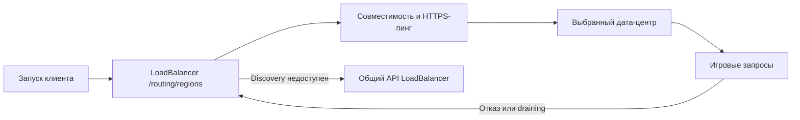

# Mosprom: backend for the Mini App game

CD прототипа из `infra/devops-regional-routing`: после quality/integration/security четыре образа проходят Trivy, получают SBOM/provenance и подписи cosign. При `PROTOTYPE_CD_ENABLED=true` выполняется доставка точных digest в отдельный проект `mosprom-prototype`, с дампом и smoke. Настройка ключа, переменных и отката: [deploy/PROTOTYPE-CD.md](https://github.com/cvn-mosprom/deploy/blob/infra/devops-regional-routing/PROTOTYPE-CD.md). Patroni этим каналом не управляется.

Server-authoritative backend for the Telegram Mini App (factory tycoon). The client only sends commands, the server owns the
state. Product spec: `docs/spec-rev4.txt`; interfaces between the parts: `docs/ARCHITECTURE.md`; progress: `PROGRESS.md`.

| Part | What | Stack |
|---|---|---|
| `api/` | public HTTP API: auth (Telegram initData / dev), commands, bootstrap, leads, quiz, events | Python 3.12, FastAPI, SQLAlchemy 2 async, asyncpg, Alembic, Pydantic v2 |
| `sim/` | stateless game simulation over internal HTTP; imports `vendor/frontend/web/src/lib` unchanged | Node 22, TypeScript, cluster workers |
| `bot/` | Telegram bot, the single owner of all background jobs (APScheduler) | aiogram 3, APScheduler 3 |
| `contract/` | JSON Schema + Pydantic generated from the frontend TypeScript contract | ts-json-schema-generator, datamodel-code-generator |
| `web/` | `Dockerfile` of the caddy image: builds the Mini App (`vendor/frontend/web`, SvelteKit adapter-static, `VITE_API_URL=/`) and serves it next to the API on one origin | pnpm, Vite, Caddy 2 |
| `e2e/` | tests against the running stack: raw HTTP scenarios, the smoke suite, and `e2e/client` (the frontend's real `HttpGameApi` in vitest) | pytest, httpx, vitest |
| `vendor/frontend/` | read-only git submodule with the game client (`git submodule update --init`) | |

## For the jury

**What it is.** The backend of a Telegram Mini App game: the player builds a kvass bottling factory, the server owns the whole
game state and the client only sends commands. Around the game: a season leaderboard (with demo bots), an 18+ application form
(lead) with consent, a quiz and analytics events, and an HR bot that receives the leads. Spec: `docs/spec-rev4.txt`.

```
 Mini App (browser) --HTTPS--> caddy --> api (FastAPI, 2 workers) --> db     Postgres 16: users, factories (state JSONB),
                               TLS +      |   |   |                          seasons, leads, quiz, events, outbox
   caddy serves the web build  web build  |   |   +-------------------> redis  rate limit, idempotency fast-path, top-100 cache
   and proxies /api/*, /health,           |   +-----------------------> sim    Node, stateless game engine (the client's own
                                          |        3 s timeout + circuit breaker                          lib/sim, unchanged)
 Telegram <--> bot (aiogram + APScheduler) --X-Internal-Token--> api /internal/*  season rotation, top-200 catch-up, bots growth;
                HR cards, /leads /export /funnel                                   reads the DB directly for analytics
```

**Run (about 4 minutes the first time: the web build is compiled inside the caddy image; needs Docker and `git submodule update --init`).**

```sh
cp .env.example .env
SIM_COMMIT=$(sh scripts/simcommit.sh) docker compose up -d --build
curl -k https://localhost/ready                      # {"status":"ready","checks":{"db":"ok","migrations":"ok","redis":"ok","sim":"ok","config":"ok"}}
curl -k https://localhost/                           # the Mini App (index.html); open https://localhost/ in a browser and accept the local cert
docker compose exec api python -m app.seed_bots      # 40 demo bots, so the leaderboard is not empty
```

**One origin.** `caddy` serves the web build (`web/Dockerfile`, built with `VITE_API_URL=/`, so the client calls relative `/api/*`) and proxies
`/api/*`, `/health`, `/ready` to the api; `/internal/*` is a 404. Every other path falls back to `index.html` (SPA routes `/play`, `/privacy`,
prerendered `/landing`). Page and API share the origin, so prod needs no CORS (`CORS_ORIGINS` only matters for a vite dev server on `:5173`).
Telegram opens `WEBAPP_URL` = `https://<DOMAIN>/` (`.env.example`: `https://${DOMAIN}/`). After a frontend bump: `docker compose build caddy && docker compose up -d caddy`.
Without Docker: `cd vendor/frontend/web && npx pnpm@10 install --frozen-lockfile && VITE_API_URL=/ npx pnpm@10 build`, then serve `build/` with the
`root * ...` / `try_files {path} {path}.html /index.html` / `file_server` block of the Caddyfile.

**Auth headers** (contract: `vendor/frontend/docs/http-contract.md`). In Telegram the client sends `X-Telegram-Init-Data: <initData>` (prod). Outside Telegram
(`DEV_AUTH=1` and `APP_ENV=dev`, the default of `.env.example`) it sends `X-Dev-User: <tg_id>` (it makes up and remembers a random id), so the web build works
in a plain browser without any setup. `Authorization: tma <initData>` and `Authorization: dev <tg_id>[:<name>]` are accepted too (curl, bot, e2e); the first
header present wins, in the order `Authorization`, `X-Telegram-Init-Data`, `X-Dev-User`. Dev auth does not exist under `APP_ENV=prod`.

**Demo without Telegram (dev auth).**

```sh
H='X-Dev-User: 1001'
curl -sk -H "$H" https://localhost/api/bootstrap                                  # creates the factory, returns version + snapshot
curl -sk -H "$H" 'https://localhost/api/season/leaderboard?tab=general&limit=5'   # tabs: general | quality | speed | uni
curl -sk -H "$H" https://localhost/api/season/summary
cd e2e && py -3.12 -m venv .venv && .venv/Scripts/python -m pip install -r requirements.txt && .venv/Scripts/python -m pytest
                                                                                  # plays the whole tutorial against the server
```

**Demo in Telegram (needs a real domain and a bot token; it cannot be done from a dev machine).** Manual checklist, in this order:
1. `.env`: `APP_ENV=prod`, `DEV_AUTH=0`, `DOMAIN=<your domain>` (DNS A record to this host, ports 80/443 open), `BOT_TOKEN`, `WEBAPP_URL=https://<your domain>/`, a real
   `INTERNAL_TOKEN` and `POSTGRES_PASSWORD`, `HR_ADMIN_TG_IDS=<your tg id>` (optionally `HR_CHAT_ID`). In @BotFather set the Mini App / menu button URL to `WEBAPP_URL`.
2. `SIM_COMMIT=$(sh scripts/simcommit.sh) docker compose up -d --build`; `curl https://<domain>/ready` shows all `ok`; `docker compose exec api python -m app.seed_bots`;
   `docker compose exec api python -m app.purge_test_users` (drops e2e / test players, so the top is clean).
3. In Telegram: `/start`, "Play": the Mini App opens on `https://<domain>/` without a "no connection" screen. Tutorial; accept an order, run a line, finish a shift
   (credits / stars change, an `etaAt` appears on a loading order); undo works; "Top" shows the demo bots and you at your place; fill the application form (18+, consent);
   take the quiz; the lead card arrives in the HR bot (`/leads`, `/funnel`, `/sources`, `/stats`, `/export`) with its status buttons.
4. Afterwards `docker compose logs api | grep -c '"status": 5'` is 0 and `docker compose logs bot` has no ERROR lines.

Show the resilience (what "stabilisation" means here): `docker compose restart api sim db`, then `/api/bootstrap` again - the
factory and its version are unchanged. `docker compose stop sim` - `/api/factory/me` keeps answering from the last stored snapshot
(`"degraded": true`), leads, quiz, events and the leaderboard do not notice, game commands answer `503 sim_unavailable`
instantly (circuit breaker). `docker compose start sim` - it heals by itself within ~10 s.

**Endpoints** (every error is `{"error": {"code", "message", "details"}}` + `X-Request-ID`; a 429 always has `Retry-After`).

| Endpoint | What |
|---|---|
| `GET /health`, `GET /ready` | liveness; readiness of Postgres, migrations, Redis, sim and required env |
| `GET /api/bootstrap` | creates user + factory, 8 h offline catch-up, season, feature flags, snapshot |
| `POST /api/command` | game command with `version` (409 `version_conflict`) and `idempotency_key` (replay-safe); the server validates `submitShift` |
| `POST /api/advance`, `GET /api/factory/me` | lazy catch-up; `factory/me` falls back to the stored snapshot while the sim is down |
| `GET /api/season/leaderboard`, `/api/season/summary`, `/api/factory/{id}` | ranking (4 tabs, gap to place 51), season result, public view of a factory |
| `POST /api/leads`, `GET`/`DELETE /api/leads/me` | application form (18+, consent, one per season), consent withdrawal (152-FZ); independent of the sim |
| `GET /api/quiz/questions`, `POST /api/quiz/answer` | quiz with server-side answers |
| `POST /api/events` | analytics batch, up to 50 events -> `{accepted, rejected}`: known events are stored, unknown names / bad timestamps / bad props are dropped and never fail the batch (422 only for a malformed body or > 50 events); 10/min + burst 6 (the client flushes every 5 s) |
| `POST /internal/seasons/rotate`, `/internal/top/advance`, `/internal/bots/grow` | bot only (token); not reachable through caddy |

**Reliability (S7).** DB statement timeout 3 s and lock timeout 2 s (`503 db_unavailable`), sim timeout 3 s, whole request 5 s
(`503 timeout` + `Retry-After: 1`; `/internal/*` exempt), requests over 1 s are logged at WARNING with `duration_ms`, sim circuit
breaker (5 consecutive failures, fail fast for 10 s, then one probe; state in the logs as `breaker_state`), JSON logs with
`request_id`, `restart: unless-stopped` everywhere, explicit workers (`API_WORKERS`, `SIM_WORKERS`) matched to CPU/RAM and database capacity, optional DB backups
(see Operations). The knobs are listed in `.env.example`.

**Where the tests are.** `api/tests` (pytest: every endpoint, error codes, idempotency, concurrency, breaker, timeouts; needs the
throwaway Postgres/Redis of `api/tests/conftest.py`), `sim/` (`npm run check`), `contract/` (generated schema vs. the client's
TypeScript), `bot/tests`, `e2e/` (against the running stack: tutorial, two tabs, 409 resync, leaderboard; `E2E_DOCKER=1` adds the
restart / dead-sim scenarios of `e2e/test_s7_resilience.py`). Commands: see "Tests" below.

**Known limitations.**
* Undo / redo and server-computed order ETAs (`etaAt`) are live (done by the frontend lead in the vendored `lib/core`; `features.undo` and
  `features.serverOrderEta` are `true`): nothing is pending from S1 / S1U any more.
* `speed` in the leaderboard is derived from produced bottles over time (the snapshot carries no flow rate yet).
* Demo bots are fillers (`BOTS_ENABLED=0` hides them everywhere) and are excluded from every analytics number. **Test players** (dev auth with a name starting `e2e`, or a
  tg_id >= 10^12; `users.is_test`) are excluded the same way from the top, ranks, season results, the HR numbers / CSV and the lead-card delivery;
  `python -m app.purge_test_users [--dry-run]` deletes them with all their data before the demo.
* Telegram opens a Mini App only over HTTPS on a real domain (`DOMAIN`); a tunnel is the last resort. The live Telegram run is the manual checklist above.
* One Postgres on one host: backups protect against data loss, not against losing the machine (copy `./backups` elsewhere).

## Run

Requirements: Docker with Compose v2, Git (submodule initialised).

```sh
cp .env.example .env                                  # dev defaults: APP_ENV=dev, DEV_AUTH=1, DOMAIN=localhost
SIM_COMMIT=$(scripts/simcommit.sh) docker compose up -d --build
docker compose ps                                     # everything healthy; `migrate` exits 0
curl -k https://localhost/health                      # caddy -> api  (-k: caddy's local CA for DOMAIN=localhost)
curl -k https://localhost/ready                       # db, migrations, redis, sim, config checks (+ media, informational)
```

PowerShell: `$env:SIM_COMMIT = (git -C vendor/frontend rev-parse --short HEAD); docker compose up -d --build`.
`SIM_COMMIT` pins the sim image (`mosprom-sim:<sha>`) to the vendored frontend commit (lib/sim), so a submodule bump is an explicit rebuild.
Without it the image is tagged `mosprom-sim:dev`.

Local auth: header `X-Dev-User: 123` or `Authorization: dev 123:Ivan` (only while `DEV_AUTH=1` and `APP_ENV=dev`); the web build sends `X-Dev-User` by itself.

| Service | Role | Host access |
|---|---|---|
| `caddy` | TLS (automatic HTTPS), gzip/zstd, serves the Mini App web build (`web/Dockerfile`), proxies `/api/*`, `/health`, `/ready` to `api:8000` and `/landing`, `/labels`, `/audio`, `/icons` to SeaweedFS | `80`, `443` (`HTTP_PORT`/`HTTPS_PORT` in `.env`) |
| `api` | FastAPI, `API_WORKERS` (2) uvicorn workers | internal `:8000` |
| `migrate` | one-shot `alembic upgrade head`, `api` waits for it | - |
| `db` | `postgres:16-alpine`, volume `pgdata` | `127.0.0.1:55432` (`mosprom`/`mosprom`) |
| `redis` | `redis:7-alpine`, caches and rate-limit counters only, no persistence | `127.0.0.1:56379` |
| `sim` | game simulation, `/health` reports `simCommit` | internal `:8080`, `127.0.0.1:58080` for debugging |
| `seaweedfs` | S3 store for the site media (`chrislusf/seaweedfs:3.68`, volume `seaweed_data`), anonymous read-only bucket `media` | internal `:8333` |
| `media-sync` | one-shot: uploads `vendor/frontend/web/static/{landing,labels,audio,icons}` into `media/` (idempotent, prunes), `caddy` waits for it | - |
| `bot` | aiogram + scheduler; idles (no crash loop) while `BOT_TOKEN` is empty | - |

Optional profiles:

* `pgbouncer` (transaction pooling): set `DB_HOST=pgbouncer`, `DB_PORT=6432`, `PGBOUNCER=1` in `.env`, then
  `docker compose --profile pgbouncer up -d --build`. `migrate` always talks to `db` directly.
* `sim-replicas`: `docker compose --profile sim-replicas up -d` adds a second sim container behind the same DNS name `sim`.
* `backup`: periodic `pg_dump` into `./backups` (see Operations).

The Compose stack above is for development and isolated E2E. For staging and production use the separate [deploy repository](https://github.com/cvn-mosprom/deploy), its preflight, restricted database roles, immutable releases and recovery runbook. Telegram opens a Mini App only over HTTPS on a real domain.
For local port conflicts, change `HTTP_PORT`/`HTTPS_PORT` in `.env`.

### Operations

* **Backups.** `docker compose --profile backup up -d backup` dumps the database (`pg_dump -Fc`) into `./backups` right away and
  then every `BACKUP_INTERVAL_H` (6) hours, keeping the newest `BACKUP_KEEP` (28). By hand: `sh scripts/backup.sh`.
  Restore (stops api + bot, safety dump first, runs the migrations afterwards): `sh scripts/restore.sh backups/<file>.dump`.
* **Media (SeaweedFS).** The big static assets (landing videos/images, product labels, audio samples, icons: ~7 MB, 85 files) are not in
  the web image; Caddy serves `/landing/*`, `/labels/*`, `/audio/*`, `/icons/*` from SeaweedFS (bucket `media`, same relative path,
  anonymous read-only, Range works for video). `media-sync` fills it on every `docker compose up` (`caddy` waits for it) and is idempotent:
  files whose md5 and headers are unchanged are skipped. After a submodule bump (`git submodule update`) re-sync without a restart:
  `docker compose run --rm media-sync` (prints `uploaded=N unchanged=M deleted=K`; removed files are pruned, `MEDIA_SYNC_PRUNE=0`
  disables pruning; it refuses to run on an empty source, so an unchecked-out submodule cannot wipe the bucket). The web image itself
  only needs a rebuild when the app code changes. Credentials: `MEDIA_S3_ACCESS_KEY` / `MEDIA_S3_SECRET_KEY` (`.env.example`; used only
  inside the compose network; `deploy/seaweedfs/s3.json` is a template filled from them by `deploy/seaweedfs/entrypoint.sh`).
  A media outage does not take the game down: `/ready` shows `checks.media: "error: ..."` but stays 200, media URLs answer 502.
  **Backup:** the media are reproducible from the repo (`media-sync` rebuilds the bucket from the submodule), so there is nothing
  to back up; if you ever store anything else in SeaweedFS, snapshot the volume (`docker run --rm -v mosprom_seaweed_data:/data -v "$PWD/backups":/b alpine tar czf /b/seaweed.tgz -C /data .`, stop `seaweedfs` first for a consistent copy).
* **Internal token.** `INTERNAL_TOKEN` is shared by api and bot (`/internal/*`, header `X-Internal-Token`). The dev placeholder
  works only with `APP_ENV=dev`; the api refuses to start with `APP_ENV=prod` unless it is a real secret (`openssl rand -hex 24`).
* **Workers.** Configure API workers, DB pools and `SIM_WORKERS` together with CPU/RAM. `SIM_WORKERS` accepts integers 0..256; 0 is a debugging mode. Production settings and connection budgets are maintained in deploy.
* **Logs.** `docker compose logs -f api`: one JSON line per request (`request_id`, `status`, `error_code`,
  `duration_ms`); breaker transitions carry `breaker_state`; `"msg": "slow request"` marks anything over 1 s.

## Contract (client commands and snapshot)

Pydantic models are generated from `vendor/frontend/web/src/lib/api/types.ts`; never edit `api/app/contract/generated/`.

```sh
contract/generate.sh     # regenerate schema + models (run after bumping the vendor/frontend submodule)
contract/check.sh        # CI / pre-commit: exit 1 if the committed contract differs from a fresh generation
```

Details: `contract/README.md`.

## Tests

| Part | Command |
|---|---|
| contract | `cd contract && py -3.12 -m venv .venv && .venv/Scripts/python -m pip install -r requirements.txt && .venv/Scripts/python -m pytest` (add `SIM_URL=http://127.0.0.1:58080` with the stack up for the live sim snapshot check) |
| bot | `cd bot && py -3.12 -m venv .venv && .venv/Scripts/python -m pip install -r requirements-dev.txt && .venv/Scripts/python -m pytest` |
| api | `cd api && py -3.12 -m venv .venv && .venv/Scripts/python -m pip install -r requirements-dev.txt && .venv/Scripts/python -m pytest`; Postgres/Redis tests need the throwaway containers from the docstring of `api/tests/conftest.py` (ports 55433 / 56380), otherwise they skip |
| sim | `cd sim && npm ci && npm run check` (typecheck, tests, bundle) |
| e2e | stack up, then `cd e2e && py -3.12 -m venv .venv && .venv/Scripts/python -m pip install -r requirements.txt && .venv/Scripts/python -m pytest`: raw HTTP scenarios, the S7 smoke suite, and `test_s10_*` (the frontend's real `HttpGameApi` via vitest in `e2e/client`, see `e2e/README.md`); `E2E_DOCKER=1` adds the restart / dead-sim scenarios |

On Linux/macOS use `.venv/bin/python` instead of `.venv/Scripts/python`.

## Layout

```
api/  sim/  bot/  web/  e2e/  contract/  scripts/  docs/  vendor/frontend/   (see docs/ARCHITECTURE.md)
docker-compose.yml  Caddyfile  .env.example  .dockerignore  PROGRESS.md
```

`scripts/simcommit.sh` prints the vendored frontend commit (`git -C vendor/frontend rev-parse --short HEAD`).

## Production: DevOps, DevSecOps и распределённый профиль

Система готова к развёртыванию на распределённой инфраструктуре и поддерживает **горизонтальное и вертикальное масштабирование серверной части игры**. Референс: **МОСКВА-1, КАЗАНЬ, САНКТ-ПЕТЕРБУРГ, МОСКВА-2 и внешний LoadBalancer**. Production-конфигурации и статус испытаний находятся в [deploy](https://github.com/cvn-mosprom/deploy); Compose этого репозитория предназначен для разработки и изолированного E2E.

Frontend в начале получает через LoadBalancer список региональных API, проверяет доступность и HTTPS-задержку («пинг») и выбирает совместимый дата-центр с лучшей медианой. API обслуживает анонимный некэшируемый `/routing/ping`, диагностику `/routing/report` и закрытый ingress-ом `/metrics`. Выбор региона меняет маршрут запросов; игровое состояние остаётся общим.

API и sim масштабируются числом экземпляров и площадок. Вертикально настраиваются CPU/RAM, API_WORKERS, SIM_WORKERS и connection pools. SIM_WORKERS принимает целое 0..256 без скрытого ограничения четырьмя; 0 — отладочный режим. В HA приложение использует PgBouncer/HAProxy и текущий PostgreSQL primary, миграции обходят PgBouncer. Patroni создаёт асинхронные реплики; увеличение их числа не увеличивает линейно производительность записи и не гарантирует RPO=0.

Redis поддерживает прямой URL и TLS/Sentinel: REDIS_SENTINEL_NODES, REDIS_MASTER_NAME, REDIS_PASSWORD, REDIS_SENTINEL_PASSWORD, REDIS_TLS, REDIS_CA_FILE. PostgreSQL TLS: DB_TLS, DB_CA_FILE. В etcd-режиме бот держит один lease для polling и планировщика; потеря подтверждения останавливает работу. Параметры ETCD_ENDPOINTS/CA_FILE/CERT_FILE/KEY_FILE передаются отдельно от исходников.

CI использует отдельные окружения API и бота, lock-файлы с хэшами, PostgreSQL/Redis с изолированными портами, тесты симулятора, миграций, контракта и настоящего клиента. Неожиданные пропуски блокируют выпуск. API, bot, sim и web собираются из одной связки backend/frontend SHA, сканируются до публикации, подписываются cosign и получают SBOM/provenance. Полный комплект предлагается одним PR в deploy. Staging обновляется автоматически; production принимает те же digest после ручного запуска.

API access logs не содержат user_id/tg_id, а production preflight требует сильных секретов, явных HTTPS origins и роли приложения без административных прав. X-Frontend-Revision проверяется при заданном FRONTEND_REVISION, чтобы старый клиент не изменял состояние нового несовместимого релиза. Все коммиты используют автора из `.github/commit-author.json`.



Результаты локальных и моделируемых проверок, а также невыполненные испытания реальных площадок: [VALIDATION](https://github.com/cvn-mosprom/deploy/blob/main/VALIDATION.md).

Локально пройдены 811 API-, 105 bot-, 200 контрактных, 104 sim- и 251 Docker E2E-сценарий. Это испытания изолированного стенда; реальные географические площадки, Patroni failover и PITR ещё требуют приёмки. Прежние High-уязвимости Python/Caddy устранены: API и bot используют Python 3.12 Alpine, Caddy пересобирается с исправленными Go и x/net. Итоговые linux/amd64 runtime прошли Trivy с 0 High/Critical, без исключений. Подробности — в VALIDATION deploy и [web/caddy/README.md](web/caddy/README.md).

Лендинг публичного прототипа расположен на `/`, игра на `/app`; Telegram WEBAPP_URL также должен оканчиваться на `/app`. Односерверный профиль без Patroni, границы демонстрационной HR-панели и правила изоляции — в deploy/PROTOTYPE.md.
