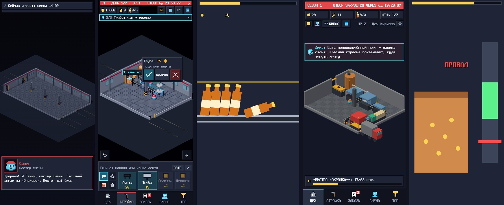
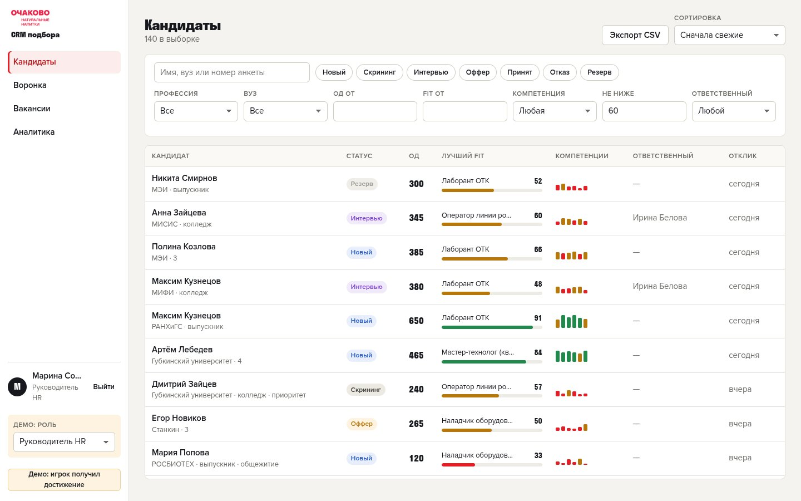
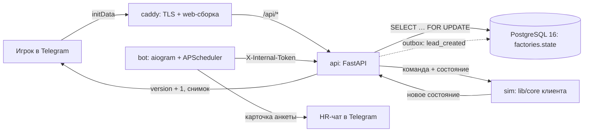
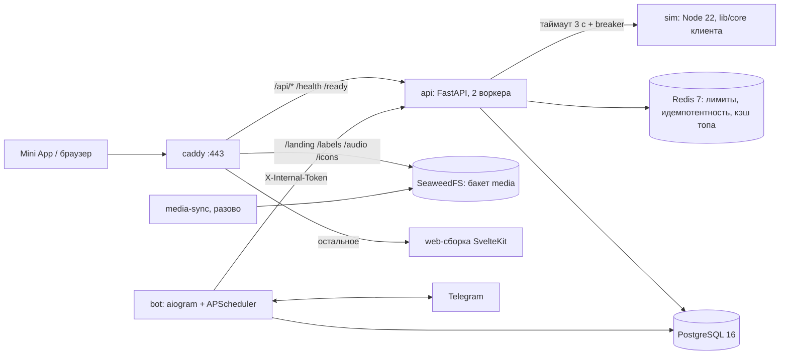
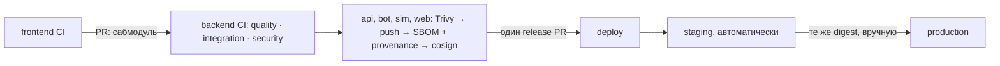

<div align="center">

# Смена на Очаково — бэкенд

**Сервер-авторитет для Telegram Mini App «Очаково»: FastAPI + Node-симулятор на общем с клиентом ядре, сезонный рейтинг, анкеты 18+ по 152-ФЗ, HR-бот и движок достижений для CRM подбора**

<sub>Хакатон **Открой#Моспром** · кейс «Очаково» — [github.com/cvn-mosprom](https://github.com/cvn-mosprom)</sub>

<!--STATS-->
**37** HTTP-операций &nbsp;·&nbsp; **27** игровых команд &nbsp;·&nbsp; **19** таблиц &nbsp;·&nbsp; **14** миграций &nbsp;·&nbsp; **38** достижений &nbsp;·&nbsp; **1800+** тестов &nbsp;·&nbsp; **9** сервисов Compose
<!--/STATS-->

[Быстрый старт](#быстрый-старт) · [Примеры](#примеры-использования) · [Как устроено](#как-устроено) · [Что внутри](#что-внутри) · [Надёжность](#надёжность) · [Демо в Telegram](#демо-в-telegram) · [CI/CD](#cicd-и-production) · [Настройка](#настройка) · [Разработка](#разработка) · [Безопасность](#безопасность) · [Ограничения](#ограничения-и-известные-проблемы)

|  |  |
|:-:|:-:|
| *Mini App: ангар → стройка → смена-миниигра → линия → итог смены* | *CRM подбора: кандидаты, очки достижений, fit по профессии* |

<sub>Всё состояние цеха живёт на сервере, клиент присылает только команды. Страницу и API отдаёт один Caddy, поэтому в проде не нужен CORS.</sub>

</div>

## Почему это интересно

* **Сервер — единственный источник правды.** Клиент шлёт команды (`POST /api/command`), сервер держит `factories.state` (JSONB) под блокировкой строки `SELECT … FOR UPDATE`. Досчёт офлайна до 8 часов, ленивый `advance` и фоновый досчёт топ-200 идут через ту же блокировку — подделать прогресс на клиенте нельзя.
* **Одна игровая логика на клиенте и сервере.** Сервис `sim` (Node 22, без состояния) импортирует `vendor/frontend/web/src/lib` без изменений: тот же `lib/core`, что крутит игру в браузере. Образ `sim` помечается коммитом фронтенда (`SIM_COMMIT`), поэтому обновление сабмодуля — всегда явная пересборка.
* **Контракт генерируется, а не переписывается.** Pydantic-модели 27 команд и снимка строятся из TypeScript-типов клиента (`types.ts` → JSON Schema → `datamodel-code-generator`); `contract/check.sh` падает, если сгенерированное разошлось с закоммиченным.
* **Идемпотентность и оптимистичные версии.** Каждая команда несёт `version` (конфликт — `409 version_conflict` с актуальной версией) и `idempotency_key` (повтор отдаёт тот же ответ без второго применения). Быстрый путь — Redis, надёжный — очередь ключей в самом состоянии цеха.
* **Деградация, а не падение.** Упал `sim` — `GET /api/factory/me` отвечает последним снимком с `"degraded": true`, анкеты, квиз, события и рейтинг работают, игровые команды мгновенно получают `503 sim_unavailable` (circuit breaker). Поднялся — сам выздоравливает за ~10 с.
* **152-ФЗ в анкете.** Анкета на практику — только 18+, с согласием и версией его текста, одна на сезон; `DELETE /api/leads/me` отзывает согласие, после отзыва можно подать заново (частичный уникальный индекс). Анкета лендинга работает без Telegram и без фиктивного игрока, отзывается по чеку.
* **Достижения → CRM подбора.** 38 достижений в 10 категориях (обучение, производство, качество, профессии, скорость, выносливость, надёжность, компания, сезон, команда), чистый движок правил и хуки после каждой команды и смены. Очки достижений и шесть компетенций становятся сигналом для HR: роли `analyst < hr < hr_lead < admin`, аналитик видит ПДн только маскированными.
* **Бот — единственный владелец фоновых задач.** aiogram 3 + APScheduler: ротация сезонов, досчёт топа, рост демо-ботов, пересчёт достижений, напоминания, карточки анкет в HR-чат и вход HR в веб через бота (`/login`, deep link).

## Как это выглядит


*Слева направо: обучение с мастером смены Санычем в пустом ангаре 24×14; стройка — тянем трубу от чана к розливу; смена-миниигра «Тапни вовремя!»; собранная линия и заказ «Бистро «Окрошка»»; провал смены. Каждое действие — команда серверу, каждый кадр — снимок, который вернул сервер.*



## Быстрый старт

Нужны Docker с Compose v2 и инициализированный сабмодуль клиента. Первая сборка — около 4 минут: web-сборка компилируется внутри образа `caddy`.

```bash
git submodule update --init
```

```bash
cp .env.example .env
```

```bash
SIM_COMMIT=$(sh scripts/simcommit.sh) docker compose up -d --build
```

```bash
curl -k https://localhost/ready
```

Ожидается `{"status":"ready","checks":{"db":"ok","migrations":"ok","redis":"ok","sim":"ok","config":"ok"}}`. Откройте https://localhost/app и примите локальный сертификат Caddy — это Mini App (на `/` — лендинг); вне Telegram (`DEV_AUTH=1`, `APP_ENV=dev`) клиент сам придумывает и запоминает dev-id игрока.

Чтобы топ не был пустым — 40 демо-ботов:

```bash
docker compose exec api python -m app.seed_bots
```

| Адрес | Что это |
|---|---|
| https://localhost/ | карьерный лендинг (старый `/landing` — редирект 308 сюда) |
| https://localhost/app | Mini App; SPA-маршруты `/privacy`, `/hr` и другие — через fallback |
| https://localhost/health | liveness |
| https://localhost/ready | готовность: Postgres, миграции, Redis, sim, обязательные переменные (+ медиа, информативно) |
| https://localhost/api/* | публичный API |
| https://localhost/routing/ping | анонимная некэшируемая проба региона для выбора дата-центра |
| https://localhost/internal/* | снаружи всегда `404` — только для бота внутри сети Compose |
| `127.0.0.1:55432` | PostgreSQL (`mosprom` / `mosprom`) |
| `127.0.0.1:56379` | Redis |
| `127.0.0.1:58080` | sim для отладки (`/health` отдаёт `simCommit`) |

Три вещи, о которые спотыкаются:

* **`SIM_COMMIT`.** Без него образ симулятора называется `mosprom-sim:dev`, и после обновления сабмодуля легко играть на старом ядре. PowerShell: `$env:SIM_COMMIT = (git -C vendor/frontend rev-parse --short HEAD)`.
* **Порты 80/443 заняты** (часто на Windows) — поменяйте `HTTP_PORT` / `HTTPS_PORT` в `.env`.
* **Сабмодуль не скачан** — `media-sync` откажется заливать пустой каталог (чтобы не стереть бакет), а `caddy` ждёт его. Сначала `git submodule update --init`.

## Примеры использования

Ответы получены на локальном стенде (`docker compose up`, `APP_ENV=dev`) и урезаны — длинные значения отмечены `…`. Для curl вне Telegram удобнее всего dev-заголовок `Authorization: dev <tg_id>[:<имя>]`.

### Первый вход: создать игрока и цех

```bash
curl -sk -H 'Authorization: dev 1001:Kirill' https://localhost/api/bootstrap
```

```json
{"version":0,"serverTime":1792869572980,
 "season":{"id":1,"startsAt":1792825172358,"endsAt":1793429972358},
 "features":{"undo":true,"serverOrderEta":true},
 "snapshot":{"player":{"id":"425","name":"Kirill","tgId":1001,…},"factory":{"layout":{"hangar":{"h":14,"w":24,…}}},…}}
```

### Команда, конфликт версии и безопасный повтор

```bash
curl -sk -X POST https://localhost/api/command -H 'Authorization: dev 1001:Kirill' -H 'Content-Type: application/json' \
  -d '{"version":0,"idempotency_key":"readme-demo-2","cmd":{"type":"renameFactory","name":"Цех README"}}'
```

```json
{"ok":true,"version":1,"result":{"rewards":{}},"events":[],"snapshot":{"factory":{"name":"Цех README",…},…}}
```

Та же версия `0` с новым ключом — конфликт, клиент пересинхронизируется:

```json
{"error":{"code":"version_conflict","message":"Factory changed since your last sync, refresh and retry","details":{"current_version":1}}}
```

А повтор с тем же `idempotency_key` (оборвалась сеть, клиент не знает, дошло ли) возвращает прежний ответ с `"version":1` — второй раз команда не применяется.

### Рейтинг сезона

```bash
curl -sk -H 'Authorization: dev 1001:Kirill' 'https://localhost/api/season/leaderboard?tab=general&limit=3'
```

```json
{"tab":"general","seasonId":1,
 "rows":[{"place":1,"playerId":"25","name":"probka3000","factoryName":"Линия Олега","value":946,"university":"Колледж (СПО)"},
         {"place":2,"playerId":"40","name":"penalife89","factoryName":"Линия Ромы","value":757,"university":"МГТУ им. Баумана"},
         {"place":3,"playerId":"28","name":"duchessgirl","factoryName":"Цех №21","value":668,"university":"МГУ им. Ломоносова"}],
 "total":323,"me":{"place":323,"name":"Kirill","factoryName":"Мой цех","value":0,"isMe":true},"gapTo51":0}
```

Вкладки: `general`, `quality`, `speed`, `uni` (битва вузов). `gapTo51` — сколько не хватает до зоны приглашений (топ-50). Ответ кэшируется в Redis на 20 секунд.

### Ошибки

Любая ошибка — `{"error": {"code", "message", "details"}}` плюс заголовок `X-Request-ID`; `429` всегда несёт `Retry-After`.

```bash
curl -sk https://localhost/api/factory/me
```

```json
{"error":{"code":"unauthorized","message":"Authorization header is required","details":{}}}
```

## Как устроено



| Сервис | Что делает |
|---|---|
| **caddy** | TLS (Let's Encrypt для реального `DOMAIN`, локальный CA для `localhost`), gzip/zstd, отдаёт web-сборку клиента (`web/Dockerfile`, `VITE_API_URL=/`), проксирует API, отдаёт медиа из SeaweedFS, закрывает `/internal/*` |
| **api** | FastAPI, `API_WORKERS` (2) воркера uvicorn, внутри сети на `:8000` |
| **migrate** | разовый `alembic upgrade head`; `api` ждёт его успешного завершения |
| **db** | `postgres:16-alpine`, volume `pgdata` |
| **redis** | `redis:7-alpine`: счётчики лимитов, быстрый путь идемпотентности, кэш топа; без persistence |
| **sim** | симуляция без состояния поверх внутреннего HTTP, cluster-воркеры (`SIM_WORKERS`) |
| **seaweedfs** | S3 для тяжёлых медиа сайта (видео лендинга, этикетки, звук, иконки — ~7 МБ, 85 файлов), анонимное чтение бакета `media`, Range для видео |
| **media-sync** | разово заливает `vendor/frontend/web/static/{landing,labels,audio,icons}` в бакет: идемпотентно по md5, удаляет пропавшие файлы |
| **bot** | Telegram-бот и все фоновые задачи; без `BOT_TOKEN` простаивает, а не падает в цикле |

Профили Compose: `pgbouncer` (transaction pooling; `DB_HOST=pgbouncer`, `DB_PORT=6432`, `PGBOUNCER=1`), `sim-replicas` (вторая реплика симулятора за тем же DNS-именем `sim`), `backup` (периодический `pg_dump`).

## Что внутри

| Часть | Что | Стек |
|---|---|---|
| `api/` | публичный API: авторизация (Telegram initData, Bearer-сессии веба, dev), команды, bootstrap, рейтинг, анкеты, квиз, события, HR | Python 3.12, FastAPI, SQLAlchemy 2 async, asyncpg, Alembic, Pydantic v2 |
| `sim/` | игровая симуляция без состояния; импортирует `lib/core` клиента без изменений | Node 22, TypeScript, cluster |
| `bot/` | бот игрока (старт, напоминания, вход в веб) и HR-бот (карточки, статусы, выгрузки) | aiogram 3, APScheduler 3 |
| `contract/` | JSON Schema + Pydantic из TypeScript-контракта клиента | ts-json-schema-generator, datamodel-code-generator |
| `web/` | `Dockerfile` образа caddy: собирает Mini App и отдаёт её рядом с API на одном origin | pnpm, Vite, Caddy 2 |
| `e2e/` | тесты против живого стека: HTTP-сценарии, smoke-набор, настоящий `HttpGameApi` клиента в vitest | pytest, httpx, vitest |
| `vendor/frontend/` | сабмодуль клиента, только чтение | |

| Группа | Эндпоинты | Таблицы |
|---|---|---|
| Здоровье и маршрутизация | `GET /health`, `GET /ready`, `GET /routing/ping`, `POST /routing/report`, `/metrics` (закрыт ingress-ом) | — |
| Игра | `GET /api/bootstrap`, `POST /api/command`, `POST /api/advance`, `GET /api/factory/me`, `GET /api/me` | `users`, `factories`, `shifts`, `reminders_sent` |
| Сезон | `GET /api/season/leaderboard`, `GET /api/season/summary`, `GET /api/factory/{id}` | `seasons`, `season_results` |
| Анкеты | `POST /api/leads`, `GET` / `DELETE /api/leads/me`, `POST /api/leads/public`, `DELETE /api/leads/public/{id}` | `leads`, `lead_events`, `outbox` |
| Квиз и события | `GET /api/quiz/questions`, `POST /api/quiz/answer`, `POST /api/events`, `POST /api/events/public` | `quiz_answers`, `events`, `landing_events` |
| Вход в веб через бота | `POST /api/auth/web/code`, `/start`, `/poll`, `GET` / `DELETE /api/auth/web/session` | `web_login_codes`, `web_login_requests`, `web_sessions` |
| HR и достижения | `GET /api/hr/me`, `GET` / `POST /api/hr/users`, `PATCH /api/hr/users/{id}` | `hr_users`, `achievements_earned`, `achievement_progress`, `player_scores` |
| Внутреннее (только бот) | `/internal/seasons/rotate`, `/top/advance`, `/bots/grow`, `/achievements/recompute`, `/internal/auth/*` | — |

Бот: у игрока — `/start`, `/login`, `/logout_web`, `/notify`, `/stop`; у HR — `/hr`, `/leads`, `/lead`, `/funnel`, `/sources`, `/stats`, `/top`, `/export`.

```
api/app/
├── main.py              сборка приложения, порядок роутеров
├── routes/              game, board, leads, quiz, events, me, webauth, hr, internal, health
├── achievements/        catalog.py (38 достижений — данные), engine.py (чистые правила), service.py, backfill.py
├── hr/access.py         роли, права, маскирование ПДн, журнал событий кандидата
├── auth.py, webauth.py  initData HMAC, dev-заголовки, Bearer-сессии через бота
├── game.py, shift.py    команды и серверная проверка смены (submitShift)
├── sim_client.py        таймауты и circuit breaker к sim
├── leads.py, public_landing.py   анкеты игры и лендинга, outbox
├── contract/generated/  сгенерированные модели — не править руками
└── seed_bots.py, purge_test_users.py
api/alembic/versions/    0001_initial … 0014_public_landing
```

## Надёжность

* **Таймауты на каждом уровне.** Statement timeout БД 3 с и lock timeout 2 с (`503 db_unavailable`), sim 3 с, весь запрос 5 с (`503 timeout` + `Retry-After: 1`; `/internal/*` исключены). Запросы дольше 1 с пишутся в лог как `slow request` с `duration_ms`.
* **Circuit breaker к sim.** 5 неудач подряд — 10 секунд быстрых отказов, затем одна проба; состояние видно в логах как `breaker_state`.
* **Явные ресурсы.** `API_WORKERS`, пулы БД и `SIM_WORKERS` (целое 0..256, 0 — отладочный режим) подбираются вместе с CPU/RAM и бюджетом соединений; production-значения ведёт `deploy`. `restart: unless-stopped` у всех сервисов, тело запроса до 2 МБ на Caddy.
* **Бэкапы.** `docker compose --profile backup up -d backup` — `pg_dump -Fc` в `./backups` сразу и каждые `BACKUP_INTERVAL_H` (6) часов, хранятся последние `BACKUP_KEEP` (28). Вручную — `sh scripts/backup.sh`; восстановление (стоп api и бота, страховочный дамп, миграции после) — `sh scripts/restore.sh backups/<файл>.dump`.
* **Медиа не роняют игру.** Нет SeaweedFS — `/ready` показывает `checks.media: "error: …"`, но отвечает 200, медиа-ссылки отдают 502. Бакет воспроизводим из репозитория, бэкапить его не нужно.

Показать устойчивость вживую:

```bash
docker compose restart api sim db
```

После перезапуска `/api/bootstrap` возвращает тот же цех и ту же версию. `docker compose stop sim` — `factory/me` отвечает снимком с `"degraded": true`, команды мгновенно получают `503 sim_unavailable`; `docker compose start sim` — выздоровление за ~10 с.

## Демо в Telegram

Mini App открывается только по HTTPS на реальном домене — с машины разработчика это не проверить. Порядок:

1. `.env`: `APP_ENV=prod`, `DEV_AUTH=0`, `DOMAIN=<домен>` (A-запись на хост, открыты 80/443), `BOT_TOKEN`, `WEBAPP_URL=https://<домен>/app`, настоящие `INTERNAL_TOKEN` и `POSTGRES_PASSWORD`, `HR_ADMIN_TG_IDS=<свой tg id>` (по желанию `HR_CHAT_ID`). В @BotFather — URL Mini App и кнопки меню равен `WEBAPP_URL`.
2. `SIM_COMMIT=$(sh scripts/simcommit.sh) docker compose up -d --build`, затем `curl https://<домен>/ready` — всё `ok`; `docker compose exec api python -m app.seed_bots` и `docker compose exec api python -m app.purge_test_users` (убирает e2e- и тестовых игроков, чтобы топ был чистым).
3. В Telegram: `/start` → «Играть» → обучение, заказ, линия, смена (кредиты и звёзды меняются, у заказа появляется `etaAt`), undo работает, «Топ» показывает ботов и вас; анкета 18+ с согласием; квиз; карточка анкеты приходит в HR-бот (`/leads`, `/funnel`, `/sources`, `/stats`, `/export`) с кнопками статусов.
4. После: `docker compose logs api | grep -c '"status": 5'` — 0, в `docker compose logs bot` нет строк ERROR.

Compose этого репозитория — для разработки и изолированного e2e. Staging, production и живой прототип (https://ochakovo.velikoss.ru, бот [@cvnprombot](https://t.me/cvnprombot)) разворачиваются из [`deploy`](https://github.com/cvn-mosprom/deploy#readme) с preflight, ограниченными ролями БД, неизменяемыми релизами и runbook восстановления.

## CI/CD и production



* **`.github/workflows/ci.yml`** — на PR, `main`: отдельные окружения API и бота из lock-файлов с хэшами, PostgreSQL и Redis на изолированных портах, тесты симулятора, миграций, контракта и настоящего клиента (`tools/e2e.sh`); неожиданные пропуски тестов блокируют выпуск (`tools/check_pytest.py`).
* **Образы одной связки.** api, bot, sim и web собираются из одного SHA бэкенда и фронтенда, сканируются Trivy до публикации (High/Critical, включая unfixed, — стоп), подписываются cosign и получают SBOM и provenance. API и бот — на Python 3.12 Alpine, Caddy пересобирается с исправленными Go и `x/net` (`web/caddy/README.md`), web-образ генерирует CSP-хэши инлайн-скриптов (`web/generate-csp.mjs`).
* **`.github/workflows/security.yml`** — еженедельное пересканирование, его же вызывает CI.
* **Выбор дата-центра.** Клиент берёт каталог регионов у LoadBalancer и меряет задержку анонимным `/routing/ping`; несовместимый клиент получает `426` до изменения состояния. Схема площадок, Patroni, Redis Sentinel и lease бота в etcd — в [`deploy`](https://github.com/cvn-mosprom/deploy#как-клиент-выбирает-дата-центр).
* **Production preflight** требует сильных секретов, явных HTTPS-origin и роли приложения без административных прав; access-логи API не содержат `user_id` и `tg_id`.

Система готова к развёртыванию на распределённой инфраструктуре с горизонтальным и вертикальным масштабированием серверной части: добавлением экземпляров API/sim и увеличением CPU/RAM и числа воркеров. Полная схема и inventory находятся в deploy. Сейчас фактически развёрнута одна VM прототипа; многоузловой Patroni и испытания четырёх площадок этим CD не запускаются.

При запуске frontend запрашивает через LoadBalancer список доступных региональных API: **МОСКВА-1, КАЗАНЬ, САНКТ-ПЕТЕРБУРГ и МОСКВА-2**. Клиент проверяет доступность и задержку HTTPS-запросов, выбирает подходящий дата-центр и направляет туда игровые запросы. При отказе соединения выполняется контролируемое переключение с сохранением правил идемпотентности.

**CD прототипа включён** для `main`: `publish-prototype` выпускает проверенные API/bot/sim/web с cosign и SLSA v1; `deliver-prototype` повторно проверяет подписи на сервере, сохраняет дамп, выполняет миграции и обновляет только эти четыре сервиса. Секрет SSH находится в environment `prototype`; разрешена только эта ветка. Лендинг — `/`, игра и меню бота — `/app`. Существующие Patroni, etcd, Xray, PostgreSQL и Redis прототипа не обновляются. Отдельные staging/production требуют собственного bootstrap. Инструкции и фактические результаты — [PROTOTYPE-CD.md](https://github.com/cvn-mosprom/deploy/blob/main/PROTOTYPE-CD.md) и [PROTOTYPE-VALIDATION.md](https://github.com/cvn-mosprom/deploy/blob/main/PROTOTYPE-VALIDATION.md).

## Настройка

Полный список — `.env.example`; значения по умолчанию рассчитаны на разработку.

| Переменная | По умолчанию | Зачем |
|---|---|---|
| `APP_ENV` / `DEV_AUTH` | `dev` / `1` | dev-авторизация (`X-Dev-User`, `Authorization: dev …`) существует только при обоих значениях; в `prod` её нет |
| `DOMAIN` | `localhost` | домен Caddy: реальный — Let's Encrypt, `localhost` — локальный CA, `http://localhost` — без TLS |
| `WEBAPP_URL` | `https://${DOMAIN}/` | адрес, который открывает Telegram |
| `BOT_TOKEN` / `BOT_USERNAME` | пусто | бот; без токена бот простаивает, а initData нечем проверить |
| `INIT_DATA_MAX_AGE_S` | 86400 | максимальный возраст initData |
| `INTERNAL_TOKEN` | `dev-internal-token` | общий секрет api и бота для `/internal/*`; в `prod` api не стартует с dev-значением (`openssl rand -hex 24`) |
| `DATABASE_URL`, `REDIS_URL`, `SIM_URL` | localhost-порты стека | подключения для запуска вне Docker |
| `API_WORKERS` / `SIM_WORKERS` | 2 / 2 | воркеры; подбирать вместе с CPU/RAM и пулами БД |
| `DB_STATEMENT_TIMEOUT_MS` / `DB_LOCK_TIMEOUT_MS` / `REQUEST_TIMEOUT_S` / `SLOW_REQUEST_MS` | 3000 / 2000 / 5 / 1000 | таймауты и порог медленного запроса |
| `SIM_TIMEOUT_S` / `SIM_BREAKER_THRESHOLD` / `SIM_BREAKER_OPEN_S` | 3 / 5 / 10 | таймаут и breaker симулятора |
| `CORS_ORIGINS` | пусто | нужен только vite dev-серверу на `:5173`; в проде страница и API на одном origin |
| `HR_ADMIN_TG_IDS` / `HR_CHAT_ID` | пусто | первые администраторы CRM и чат для карточек анкет |
| `BOTS_ENABLED` | 1 | демо-боты в рейтинге (`0` — скрыть везде; в аналитику они не попадают никогда) |
| `BACKUP_INTERVAL_H` / `BACKUP_KEEP` | 6 / 28 | профиль `backup` |
| `MEDIA_S3_ACCESS_KEY` / `MEDIA_S3_SECRET_KEY` / `MEDIA_SYNC_PRUNE` | dev-значения / 1 | ключи записи в SeaweedFS внутри сети, удаление пропавших файлов |
| `PGBOUNCER`, `DB_HOST`, `DB_PORT` | 0, `db`, 5432 | переключение на профиль `pgbouncer` |
| `DB_TLS`, `DB_CA_FILE` | выкл. | TLS до PostgreSQL в распределённом профиле |
| `REDIS_SENTINEL_NODES`, `REDIS_MASTER_NAME`, `REDIS_PASSWORD`, `REDIS_SENTINEL_PASSWORD`, `REDIS_TLS`, `REDIS_CA_FILE` | пусто | Redis через Sentinel и TLS вместо прямого `REDIS_URL` |
| `ETCD_ENDPOINTS` + CA/сертификат/ключ | пусто | lease бота в etcd: один активный экземпляр polling и планировщика |
| `FRONTEND_REVISION` | пусто | при заданном значении API отвергает другой `X-Frontend-Revision` кодом `426 client_update_required` |

## Разработка

**Контракт.** Модели команд и снимка генерируются из `vendor/frontend/web/src/lib/api/types.ts`, каталог `api/app/contract/generated/` руками не правится. Пересоздать после обновления сабмодуля:

```bash
contract/generate.sh
```

Проверить в CI и pre-commit (`exit 1`, если закоммиченное расходится со свежей генерацией; подробности — `contract/README.md`):

```bash
contract/check.sh
```

**Тесты.** На Linux/macOS — `.venv/bin/python`, на Windows — `.venv/Scripts/python`.

| Часть | Команда | Последний прогон (`PROGRESS.md`) |
|---|---|---|
| api | `cd api && python3.12 -m venv .venv && .venv/bin/pip install -r requirements-dev.txt && .venv/bin/pytest` — тестам с Postgres/Redis нужны одноразовые контейнеры из докстринга `api/tests/conftest.py` (порты 55433 / 56380), иначе они пропускаются | 1054 |
| bot | `cd bot && python3.12 -m venv .venv && .venv/bin/pip install -r requirements-dev.txt && .venv/bin/pytest` | 146 |
| e2e | стек поднят, затем `cd e2e && … && .venv/bin/pytest`; `E2E_DOCKER=1` добавляет сценарии с перезапуском и мёртвым sim | 360 + 6 пропущено |
| contract | `cd contract && … && .venv/bin/pytest` (с `SIM_URL=http://127.0.0.1:58080` — ещё и сверка живого снимка) | 200 |
| sim | `cd sim && npm ci && npm run check` — типы, тесты, бандл | 103 |

Smoke-набор (`e2e/test_s7_smoke.py`, 36 сценариев) нашёл пять настоящих `500`: NUL в ключе идемпотентности и имени цеха, NUL в `?university=`, id из 5000 цифр, tg_id больше bigint. Все исправлены и держатся тестами.

**Миграции** — Alembic, линейные, от `0001_initial` до `0014_public_landing`; сервис `migrate` прогоняет их перед стартом `api`.

**Тестовые игроки.** Dev-игрок с именем на `e2e` или tg_id ≥ 10¹² помечается `users.is_test` и исключается из топа, мест, итогов сезона, HR-цифр, CSV и доставки карточек. Перед демо — `python -m app.purge_test_users [--dry-run]`.

**Логи.** `docker compose logs -f api` — одна JSON-строка на запрос (`request_id`, `status`, `error_code`, `duration_ms`); идентификаторы игроков в access-лог не пишутся.

## Безопасность

* **Подлинность игрока — подпись Telegram.** initData проверяется HMAC по `BOT_TOKEN` с ограничением возраста (`INIT_DATA_MAX_AGE_S`); порядок заголовков — `Authorization` → `X-Telegram-Init-Data` → `X-Dev-User`, dev-вариантов в `prod` не существует.
* **Внутренние ручки не видны снаружи.** `/internal/*` закрыт на Caddy явным `404` и требует `X-Internal-Token`; в `prod` api отказывается стартовать с dev-токеном.
* **ПДн по ролям.** В CRM `analyst` видит кандидатов и аналитику с маскированными ПДн и без записи, `hr` и `hr_lead` — полные данные и запись (`hr_lead` ещё вакансии и выгрузку), `admin` — плюс управление пользователями. Права отдаёт `GET /api/hr/me`, интерфейс прячет недоступное, но решает сервер.
* **Согласие и отзыв.** Анкета хранит версию текста согласия; отзыв (`DELETE /api/leads/me`, у анкеты лендинга — по чеку `receipt_token`, в базе только его хэш) уходит в outbox и в HR-бот.
* **Лимиты.** Redis rate limit на каждую группу ручек (`bootstrap`, `command`, `advance`, `leaderboard`, `leads`, `quiz`, `events`, `auth`, `hr`, публичные анкеты и события лендинга), `429` с `Retry-After`. События — до 50 в пачке, неизвестные отбрасываются, не роняя пачку.
* **Входные данные.** NUL-байты и ошибки Postgres `22021` / `22P05` превращаются в `422`, а не в `500`; размер состояния цеха контролируется (предупреждение на 150 КБ и тест-аудит).

## Ограничения и известные проблемы

| Проблема | Статус |
|---|---|
| `speed` в рейтинге выводится из произведённых бутылок за время | в снимке пока нет скорости потока |
| Демо-боты — наполнители топа | `BOTS_ENABLED=0` скрывает их, из аналитики они исключены всегда |
| Живой прогон в Telegram требует домена и токена | ручной чек-лист выше; туннель — крайний случай |
| Один Postgres на одном хосте | бэкапы защищают от потери данных, но не от потери машины — копируйте `./backups` наружу; распределённый вариант — в [`deploy`](https://github.com/cvn-mosprom/deploy#readme) |
| CRM подбора: кандидаты, воронка, заметки, сообщения (этапы C2, C4–C6 в `docs/hr-crm-plan.md`) | в работе; готовы движок достижений (C1) и роли HR (C3), веб-CRM пока работает на демо-данных |

| Документ | Что внутри |
|---|---|
| [`docs/spec-rev4.txt`](docs/spec-rev4.txt) | спецификация бэкенда, ревизия 4 |
| [`docs/ARCHITECTURE.md`](docs/ARCHITECTURE.md) | интерфейсы между частями |
| [`docs/web-auth.md`](docs/web-auth.md) | вход в веб через бота — контракт для клиента |
| [`docs/hr-crm-plan.md`](docs/hr-crm-plan.md) | план CRM подбора и каталог достижений |
| [`PROGRESS.md`](PROGRESS.md) | что сделано по спринтам, числа тестов, что дальше |
| [`contract/README.md`](contract/README.md) · [`e2e/README.md`](e2e/README.md) | генерация контракта · сквозные тесты |
| [`frontend`](https://github.com/cvn-mosprom/frontend#readme) | игра, лендинг и CRM подбора |
| [`deploy`](https://github.com/cvn-mosprom/deploy#readme) | поставка, прототип для жюри, распределённый профиль |
